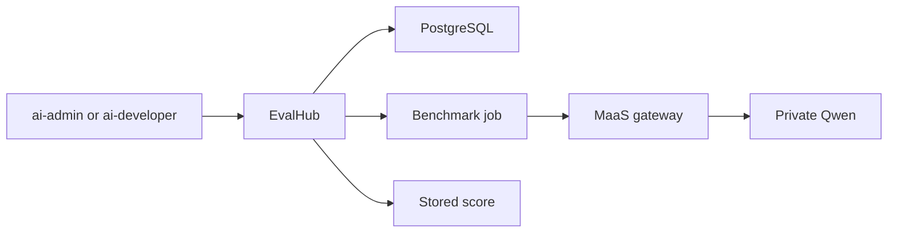

# Stage 060: Model Evaluation

## Why This Matters

A playground answer is a draft. A marketing or product team still has to decide whether the model is fit to use: does it follow instructions, does it stay safe in front of customers, and, once product documents are connected, does it stay on those facts.

OpenShift AI 3.5 measures that with EvalHub. EvalHub runs a named test against a model that is already served, stores the score, and lets the same test be repeated on another model. The score is the decision record. The draft is not.

## Architecture



TrustyAI stays `Removed` in Stage 010. This stage's sync hook sets it to `Managed`, which installs the EvalHub operator. EvalHub and its database live in the `evalhub` project. Jobs call a model through the Stage 040 gateway, so the same API key, limit, and private-model boundary apply to the test as to a person.

## What This Stage Adds

- TrustyAI `Managed` on the `DataScienceCluster`, applied by a sync hook because Stage 010 ignores that field.
- EvalHub in the `evalhub` project, single-tenant, with PostgreSQL. The database password is created by `deploy.sh` and is not in Git.
- Providers `lm-evaluation-harness`, `garak`, `guidellm`, and `ragas`.
- Collections `standard-llm-evals-v1` and `safety-and-fairness-v1`.
- Submit rights for `rhods-admins` (`ai-admin`) and `rhoai-developers` (`ai-developer`).
- NeMo Guardrails on the MaaS gateway. A caller with a key for `qwen3-6-27b` or `qwen3-8-27b-int4` can check a draft at `/models-as-a-service/<model>/guardrails/checks` before or after generation. The check blocks email addresses, phone numbers, card numbers, US Social Security numbers, and text that contains a password, secret, API key, or token. It does not decide whether the draft matches product pages.

## What To Notice And Why It Matters

Each loaded suite answers a different question:

| Suite | Question |
|-------|----------|
| `standard-llm-evals-v1` | Can this model follow instructions and handle hard questions? Use one benchmark, such as `ifeval`, before offering a model to a writing team. The full collection includes MMLU-Pro, GPQA, math, and long-context tests and will occupy a GPU for a long time. |
| `safety-and-fairness-v1` | Does the model produce toxic or unsafe text before anything customer-facing? |
| `guidellm` | Is the model fast enough for the team? |
| `ragas` | Once a document search sits in front of the model, are answers relevant and consistent with those documents? |

`ragas` does not score product blogs on this cluster yet. No approved document set is connected to the models. A strong general score does not mean the model knows the product.

Compare the same benchmark on `qwen3-6-27b` and `qwen3-8-27b-int4`. Keep unpublished tests on those private models. `gpt-4o-mini` sends prompts to OpenAI.

LM-Eval is deprecated in OpenShift AI 3.5. This stage does not create `LMEvalJob` resources.

## How Red Hat And Open Source Make It Work

[EvalHub](https://docs.redhat.com/en/documentation/red_hat_openshift_ai_self-managed/3.5/html/evaluating_ai_systems/evaluating-llms-with-evalhub_evaluate) is the OpenShift AI 3.5 evaluation service. The TrustyAI operator installs it from an `EvalHub` custom resource. Each benchmark runs as its own job. PostgreSQL keeps the job record. The model under test is one already published by Stage 040.

## Trust Boundaries

- EvalHub authentication stays on. A caller needs an OpenShift token and the `X-Tenant: evalhub` header.
- The model API key is a Secret in the `evalhub` project (`model-auth`, data key `api-key`). It is not committed.
- The database password is a Secret created by `deploy.sh`. It is not committed.
- Private-model jobs stay on the MaaS gateway. External-model jobs leave the platform, the same way an interactive call would.
- EvalHub does not publish the score anywhere except its own API and database.

## Red Hat Products Used

- [Red Hat OpenShift AI](https://www.redhat.com/en/technologies/cloud-computing/openshift/openshift-ai) provides TrustyAI and EvalHub.
- [Red Hat OpenShift](https://www.redhat.com/en/technologies/cloud-computing/openshift) provides the project, PostgreSQL runtime image, identity, and route.

## Open Source Projects To Know

- [lm-evaluation-harness](https://github.com/EleutherAI/lm-evaluation-harness) runs the standard language-model benchmarks.
- [RAGAS](https://docs.ragas.io/) scores retrieval-grounded answers.
- [Garak](https://github.com/NVIDIA/garak) probes model safety.
- [GuideLLM](https://github.com/vllm-project/guidellm) measures inference speed.

## Deploy And Validate

```bash
./stages/060-model-evaluation/deploy.sh
./stages/060-model-evaluation/validate.sh
```

Deploy after Stage 040 so a private model exists to score. Submitting a job, storing the model API key, and reading the result are in [Operations](../../docs/OPERATIONS.md).

## References

- [Evaluating AI systems](https://docs.redhat.com/en/documentation/red_hat_openshift_ai_self-managed/3.5/html-single/evaluating_ai_systems/index)
- [Evaluate LLMs with EvalHub](https://docs.redhat.com/en/documentation/red_hat_openshift_ai_self-managed/3.5/html/evaluating_ai_systems/evaluating-llms-with-evalhub_evaluate)

## Next Stage

This is the last stage on the published workshop path.
